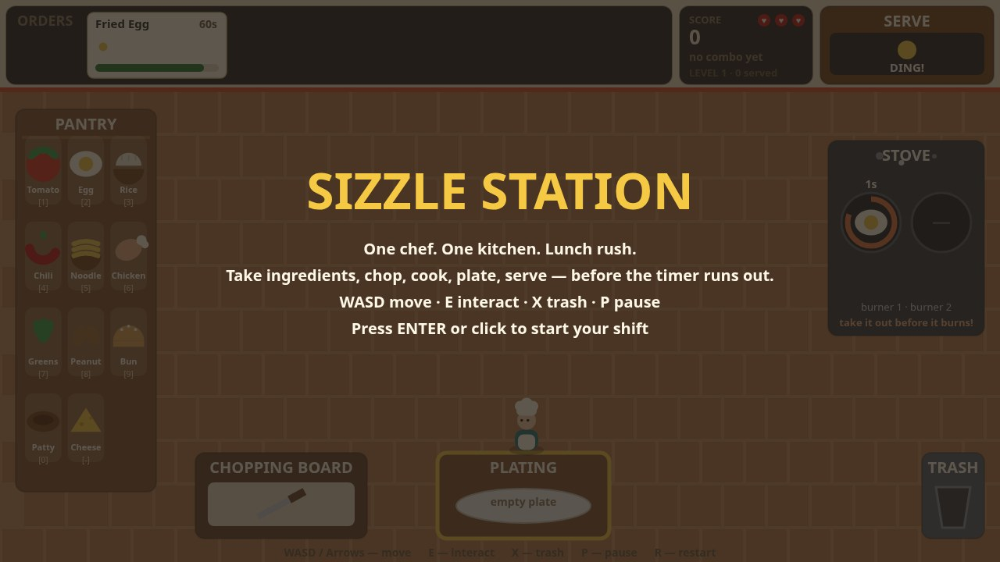
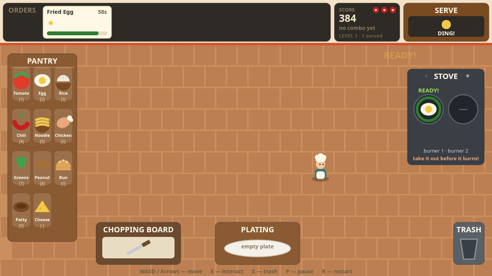
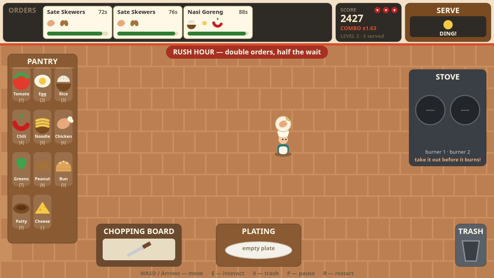
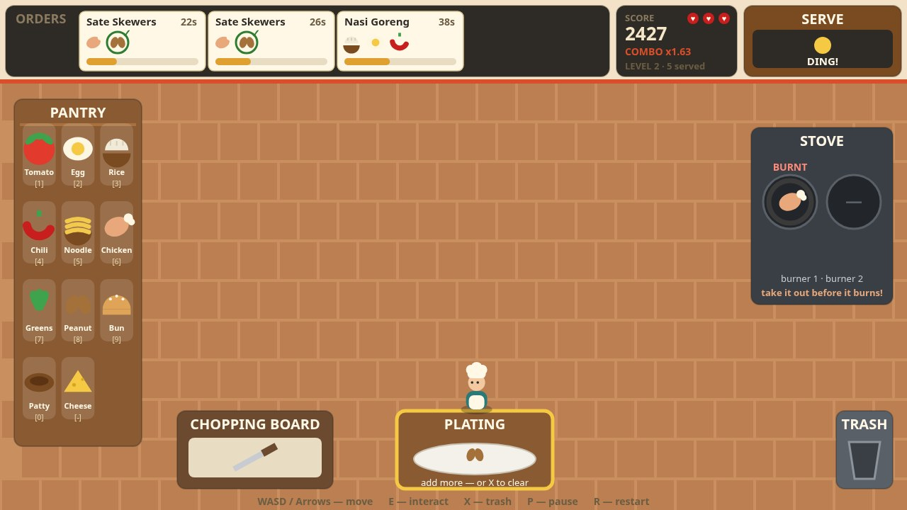

# Sizzle Station

[](https://make.fun/bounty/best-cooking-game-20261125-0137?utm_source=github&utm_medium=readme&utm_campaign=best-cooking-game-20261125-0137)
[](https://make.fun/bounty/best-cooking-game-20261125-0137/leaderboard?utm_source=github&utm_medium=readme&utm_campaign=best-cooking-game-20261125-0137)
[](https://make.fun/bounty/best-cooking-game-20261125-0137?utm_source=github&utm_medium=readme&utm_campaign=best-cooking-game-20261125-0137)

A one-chef kitchen rush game built with vanilla JavaScript and Canvas 2D.
No libraries, no network. Procedural WebAudio synth sound, system fonts.

Entry for the make.fun bounty [best-cooking-game-20261125-0137](https://make.fun/bounty/best-cooking-game-20261125-0137) — "Make the best cooking game".

## How to Play

- Move with **WASD** or **arrow keys**.
- Press **E** to interact.
- Press **X** to discard to trash.
- Press **P** to pause.
- Press **R** to restart after game over.
- Mouse click can also interact with the nearest station (click a pantry icon to pick that ingredient).

Game loop:

1. Get ingredients at the **Pantry**.
2. Chop at the **Chopping Board** (~2 seconds).
3. Cook at the **Stove** (2 burners, ~5–6 seconds; burns if left).
4. Assemble at the **Plate Station** — the plate must match an open order exactly.
5. Deliver to the **Serve Window** before the order timer runs out.

You can carry max 1 item. Leave food on the stove too long and it burns — burnt food can't be plated and has to be trashed.

## Recipes

| Dish | Ingredients | Prep |
| --- | --- | --- |
| Tomato Salad | tomato | chop |
| Fried Egg | egg | cook |
| Nasi Goreng | rice, egg, chili | cook + cook + chop |
| Sate Skewers | chicken, peanut | chop+cook + chop |
| Mie Ayam | noodle, chicken, greens | cook + chop+cook + chop |
| Burger Kilat | bun, patty, tomato, cheese | — + cook + chop + — |

Harder recipes unlock as you level up (level = 1 + served / 3). Every 5th served dish triggers a 20-second **Rush Hour** with double order spawns.

## Scoring

- Each served dish pays its base value (100–300 by recipe) plus 5 points per second left on the order timer.
- Serving dishes in a row without losing an order builds a combo multiplier: ×1.00, then +×0.125 per combo step, up to ×2.00.
- Losing an order (timer runs out) resets the combo. Lose 3 orders and the shift ends.

## Controls

| Key | Action |
|-----|--------|
| WASD / Arrows | Move |
| E | Interact |
| X | Discard to trash |
| P | Pause |
| R | Restart after game over |
| Mouse click | Interact with nearest station |

## Screenshots






The screenshots are real renders of the game, staged deterministically from a seeded world (`?shot=start|play|rush|serve&seed=1`).

## Project Structure

- `main.ts` — Node 22 entry program: copies `game/` and `screenshots/` to `/output`, writes `dossier.json`.
- `game/index.html` + `game/src/`:
  - `config.js` — constants, recipes, stations, palette
  - `random.js` — seeded RNG (mulberry32)
  - `world.js` — pure game logic (orders, prep, burn, scoring, combos)
  - `input.js` — keyboard + mouse input
  - `audio.js` — procedural WebAudio sound effects
  - `render.js` — all canvas drawing
  - `shots.js` — deterministic autopilot that stages the screenshots
  - `main.js` — boot, fixed-timestep loop, shot mode
- `vendor/makefun-game.ts` — kit library, unchanged.
- `screenshots/` — 4 original renders: start, play, rush, serve.
- `serve.ts` — local static server. Run `node serve.ts` → http://localhost:8080.
- `tests/` — automated world-logic tests (`node --test tests/`).

## Running Locally

```bash
node serve.ts
```

Then open http://localhost:8080. No build step, no dependencies.

## License

MIT — see [LICENSE](LICENSE).
